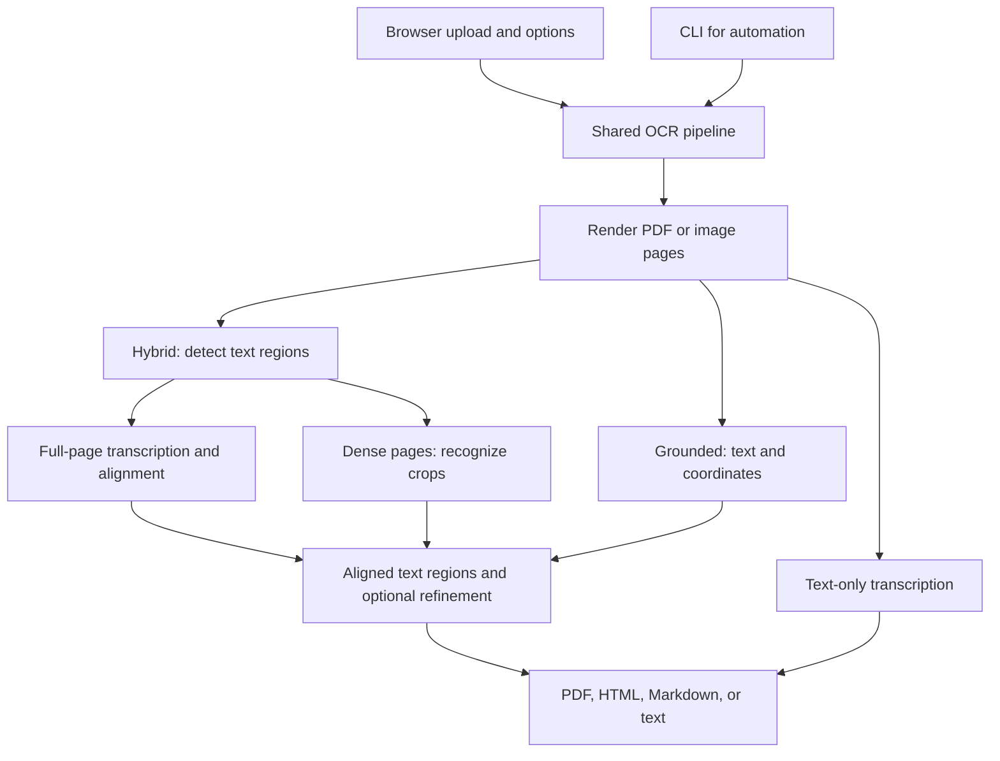

Your scans should be as useful as the documents you type: searchable, selectable, and ready to work with. I built [local-llm-pdf-ocr](https://github.com/ahnafnafee/local-llm-pdf-ocr) to bring that experience to scanned PDFs, handwritten notes, and page photos using vision models on your own machine. Drop a document into the browser, choose a local model, and download a searchable PDF that keeps the original page visible. The app also exports HTML, Markdown, and plain text, with dedicated processing for dense handwriting and models that return coordinates. Surya detection and a dynamic-programming aligner handle page geometry behind the interface, and a CLI supports scripted workflows.

<AppDownloadCTA
  heading='Run Local LLM PDF OCR'
  subtext='Requires Git, Python 3.10 or newer, uv, and a running vision-capable model endpoint. After setup, use the browser interface.'
  github='https://github.com/ahnafnafee/local-llm-pdf-ocr'
  documentation='https://github.com/ahnafnafee/local-llm-pdf-ocr/blob/main/README.md#-getting-started'
>

In [LM Studio](https://lmstudio.ai/docs/developer/core/server), load a vision model such as `allenai/olmocr-2-7b` and start its local server at `http://localhost:1234/v1`. Install [uv](https://docs.astral.sh/uv/getting-started/installation/) if needed, then run:

```bash
git clone https://github.com/ahnafnafee/local-llm-pdf-ocr.git
cd local-llm-pdf-ocr
uv sync --extra web
uv run local-llm-pdf-ocr-server --port 8000
```

Open [localhost:8000](http://localhost:8000). Drop a document, select **Hybrid** and the loaded model, then choose **Run OCR**. Download the searchable PDF when it finishes. Change the model endpoint under **Advanced** if you use a different server.

Download the model weights before working offline. Keep the configured model endpoint local so document processing stays on your own machine.

</AppDownloadCTA>

<figure className='not-prose my-6'>
  
  
  <figcaption className='mt-2 text-center text-sm text-gray-500 dark:text-gray-400'>
    The main workflow stays in the browser: upload, choose a model, run OCR, and download the result.
  </figcaption>
</figure>

Jump to [the browser workflow](#from-a-scan-to-a-searchable-document), [engine choices](#choose-the-engine-in-the-browser), [the architecture](#how-the-hybrid-engine-connects-text-to-the-page), or [troubleshooting](#get-a-difficult-page-working).

## From a Scan to a Searchable Document

A scan preserves a document's appearance, but the words remain pixels. That becomes frustrating when I need a name in a stack of forms or a passage from handwritten notes. A transcript helps, but I also want to search and select text where it appears on the original page.

The browser app makes that the default deliverable. Drag in a PDF or image, choose **Searchable PDF**, and start processing. Per-page progress shows the work advancing, and **View text** exposes the raw extraction for inspection. Multiple-file selection handles a collection of scans in the same session, with a merged Markdown download to bring their extracted text together.

The output keeps the page image visible and adds an invisible text layer. In the form below, blue selection reveals the recognized printed labels and handwriting. The same page can be searched or copied in a PDF reader without replacing its layout with a recreated document.

<figure className='not-prose my-6'>
  
  <figcaption className='mt-2 text-center text-sm text-gray-500 dark:text-gray-400'>
    Printed text and handwritten entries become searchable over the original scan. The blue highlight reveals the
    normally invisible OCR layer.
  </figcaption>
</figure>

## Choose the Engine in the Browser

The interface offers **Hybrid**, **Grounded**, and **Text only**, with options that adapt to the selected engine. Hybrid is the starting point for searchable documents because it combines a text detector with a vision model that only needs to transcribe what it sees.

| Engine    | What happens behind the interface                                                       | Choose it for                                                   |
| --------- | --------------------------------------------------------------------------------------- | --------------------------------------------------------------- |
| Hybrid    | Surya locates text; the local model transcribes it; alignment connects words to regions | Scans, forms, handwriting, and models that return ordinary text |
| Grounded  | A compatible model returns text and coordinates together                                | Models with reliable structured coordinate output               |
| Text only | The model transcribes each page without detection or alignment                          | Text extraction for notes, search indexing, or RAG              |

Dense-page processing is part of Hybrid rather than another engine to install. It switches from full-page transcription to individual text crops when the page needs it. Grounded skips separate detection and alignment, while Text only skips geometry entirely.

Model choice remains flexible. LM Studio is the default endpoint, and Ollama, vLLM, SGLang, or another OpenAI-compatible server can be configured under **Advanced**. The model picker discovers available models, and preflight verification checks the requested model before processing. Use a vision-capable model: returning plain text is compatible with Hybrid, but the model still has to understand the page image.

## Give Handwriting and Page Photos the Attention They Need

Dense handwriting makes full-page recognition harder because many similar lines compete within one image. The pipeline can instead send each detected region through its own recognition call, keeping the model's attention on a smaller part of the page. Automatic mode uses a default threshold of 60 detected boxes and can also retry per-box when full-page alignment matches fewer than half the regions.

For a page with repeated or missing lines, open **Advanced**, set **Dense mode** to **Always**, and try that page again. It makes more model requests, but it gives tightly packed notes a processing route built around their structure. Dense machine-print crops receive neighbor masking to reduce adjacent-line leakage; handwriting keeps its surrounding strokes because they can cross detection boundaries.

Photographed documents have a separate preparation step. Automatic preprocessing detects a tilted page outline and can correct perspective and illumination for recognition. Coordinates then map back onto the original photograph, so the output preserves the image you supplied. Compare automatic preprocessing with **Never** if the detected outline does not describe the page correctly.

<figure className='not-prose my-6'>
  
  <figcaption className='mt-2 text-center text-sm text-gray-500 dark:text-gray-400'>
    Start with the defaults, then tune a difficult page through the same browser interface.
  </figcaption>
</figure>

## Export for the Work You Want to Do Next

The **Output format** control makes the tool useful beyond PDF conversion. Choose a searchable PDF for an archive, an HTML overlay for browser-based inspection, or Markdown and text for content that will move into other tools.

| Output         | What you receive                                                                                  |
| -------------- | ------------------------------------------------------------------------------------------------- |
| Searchable PDF | The visible page image with an invisible, selectable text layer                                   |
| HTML overlay   | Page images with a selectable text overlay, optional hover inspection, and optional inline images |
| Markdown       | Extracted text in a format suited to editing and downstream processing                            |
| Plain text     | Transcription without document-format markup                                                      |

HTML can be packaged as one self-contained file with inline images. Its hover-text option exposes the recognized content over a region, which is useful when checking the overlay. Text-only mode is a direct route for retrieval preparation because it avoids geometry work when a selectable page is not part of the deliverable.

Inputs include PDF, JPEG, PNG, BMP, WebP, AVIF, and TIFF. A multi-frame TIFF becomes multiple output pages, so archives do not need a separate image-to-PDF conversion before OCR.

## How the Hybrid Engine Connects Text to the Page

The architecture separates locating text from recognizing it. Surya's detection predictor supplies text regions without running its recognition model, and the configured vision model supplies transcription. A shared `OCRPipeline` orchestrates those stages for both the browser and CLI.

The remaining problem is assigning the model's lines to the right regions. A proportional split can move a caption into a neighboring column or combine unrelated form fields. I use a Needleman-Wunsch-style dynamic program to find a monotonic alignment between ordered boxes and text lines, with costs that favor plausible text-to-width fit while allowing skipped boxes and unmatched lines.

The [aligner](https://github.com/ahnafnafee/local-llm-pdf-ocr/blob/main/src/pdf_ocr/core/aligner.py) tries row-major and column-major box orderings and chooses the lower-cost result. Different models can therefore read a two-column page in different orders without requiring a separate model-specific alignment implementation. Unmatched model lines attach to nearby matched regions, and sizeable empty regions can receive a crop-recognition pass.



PyMuPDF writes a sandwich PDF with the rasterized page as the visible layer. Invisible text is scaled to its assigned region, giving selection a geometric connection to the underlying scan. A detected region and a recognized line remain estimates, so exact selection placement depends on both stages.

## Grounded OCR Without Silent Empty Output

Grounded mode lets a compatible model return coordinates alongside the text. The project documents working Qwen2.5-VL and Qwen3-VL configurations; select **Grounded** and the appropriate loaded model in the interface. Models that return only prose or Markdown belong on Hybrid.

If a page returns no usable grounded blocks, processing stops before writing output and identifies the affected pages. This also applies to blank pages. That behavior prevents a completed-looking run from quietly producing an image-only PDF when the requested text layer is missing.

The distinction matters because a model's general ability to read an image does not establish its coordinate format. Keeping both engines available lets the user choose a suitable model without committing the rest of the workflow to that model's response structure.

## Get a Difficult Page Working

The browser's **Advanced** controls expose page range, rendering DPI, image dimensions, concurrency, refinement, and preprocessing. Use a representative page while tuning, then apply the settings to the full document.

| What you see                                | What to try in the interface                                               |
| ------------------------------------------- | -------------------------------------------------------------------------- |
| The requested model is unavailable          | Select its exact loaded ID and check the endpoint                          |
| Repeated or missing lines                   | Hybrid with Dense mode set to Always                                       |
| Grounded reports no usable blocks           | Select Hybrid, or load a model that returns structured coordinates         |
| GLM-OCR exceeds image capacity in Ollama    | Use the documented maximum image dimension of 640                          |
| A page photo is distorted after preparation | Compare automatic preprocessing with Never                                 |
| Higher concurrency slows progress           | Lower concurrent requests and check the model server's memory and queueing |

Concurrency limits in-flight model requests; it does not start extra copies of the model. Full-page and crop-heavy workloads have different costs, so increase it when the server has room rather than assuming a larger number always wins.

For a quick quality check, search a visible phrase, copy across a paragraph or column boundary, and compare handwritten identifiers with the scan. The [confidence evaluator](https://github.com/ahnafnafee/local-llm-pdf-ocr/blob/main/scripts/confidence_eval.py) goes further by measuring geometry, character errors, word-level similarity, and structural coverage against project fixtures. Saved per-document baselines make changes traceable to the part of the pipeline they improve.

## CLI Support for Automation

Everything above can be done in the browser. The CLI is also available when the same configuration needs to run from a script or batch workflow:

```bash
uv run local-llm-pdf-ocr scan.pdf scan_ocr.pdf
```

Its options cover the same engine, model, endpoint, page selection, and tuning controls. The [repository README](https://github.com/ahnafnafee/local-llm-pdf-ocr/blob/main/README.md) documents the full command surface, example documents, and evaluation tools.

For a first run, use the web interface and a document you already know well. Search it, select a passage, and download the format your next task needs. The [source](https://github.com/ahnafnafee/local-llm-pdf-ocr) is MIT-licensed and available to adapt to your own document workflow.
