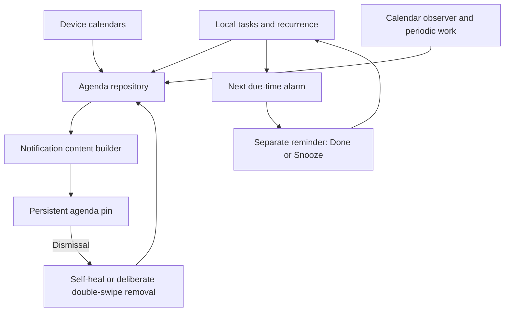

A calendar reminder disappears when I swipe it away, even though the appointment still matters. I built [Pinned Calendar](https://pinnedcalendar.ahnafnafee.dev) to keep upcoming events and local tasks visible in one persistent Android notification. The app now includes recurring tasks, due-time reminders with Done and Snooze actions, and a live layout preview, and it is [available on Google Play](https://play.google.com/store/apps/details?id=dev.ahnafnafee.pinnedcalendar). It reads calendars already synced to the phone and stores tasks on-device, with no sign-in or internet permission. Kotlin and Jetpack Compose handle the app; a self-healing notification keeps the agenda within a swipe of whatever I am doing.

<AppDownloadCTA
  heading='Install Pinned Calendar'
  subtext='Free and open source. Available on Google Play for Android 8.0 and newer, with signed APKs on GitHub.'
  playStore='https://play.google.com/store/apps/details?id=dev.ahnafnafee.pinnedcalendar'
  github='https://github.com/ahnafnafee/pinned-calendar'
  releases='https://github.com/ahnafnafee/pinned-calendar/releases/latest'
  web='https://pinnedcalendar.ahnafnafee.dev'
>

1. Install the app, then grant **Calendar** access and allow notifications when Android asks.
2. Turn on **Pin to notifications** in Settings. Choose the calendars and look-ahead window you want to see.
3. Add a to-do, set a date or repeat rule, and use the notification preview to adjust the agenda's density.

Task reminders are enabled by default. If your phone delays background updates, the app's **Reliability** setting offers a battery-optimization exemption.

</AppDownloadCTA>

## Keep the Plan Where You Already Look

The notification shade is useful because it follows me between apps. Pinned Calendar puts events and tasks on that surface, grouped by day and marked with calendar or task-priority colors. An event row opens its calendar entry; the rest of the pin opens the app.

That changes what a reminder has to do. The agenda can stay visible without sounding an alarm every time it refreshes, while a task that is actually due can produce a separate alert. Keeping those roles separate became more important as the app grew beyond a read-only week view.

<div className='not-prose my-6 flex flex-col items-center justify-center gap-4 sm:flex-row sm:items-start'>
  
  
</div>

## Tasks That Follow Your Schedule

Local to-dos now carry due dates, times, notes, and priorities. Quick date choices cover today, tomorrow, and next week, with a picker for a specific time. The list groups unfinished work into Overdue, Today, and Upcoming, with completed items kept separately. An unfinished task carries forward instead of disappearing when its original date passes.

Recurrence supports daily, weekly, monthly, and yearly presets, plus custom intervals and selected weekdays. A series can end on a date or after a chosen number of occurrences. Completing a recurring task advances it to the first upcoming occurrence, skipping missed dates while preserving its scheduling intent.

That last detail is easy to overlook. A monthly task near the end of a month should not drift because February is shorter, and a local morning reminder should retain its meaning across time-zone offset changes. The recurrence logic handles month-end and leap-year cases in the task model, where those rules can be tested independently of the interface.

## Act on a Reminder Without Opening the App

To-do reminders use their own alerting, dismissible notifications. **Done** completes the scheduled occurrence, including advancing a recurring task. **Snooze** postpones that occurrence's reminder for 30 minutes without changing the task's original due time. Neither action removes the pinned agenda.

`AlarmManager` schedules the next due task, then the receiver schedules the following one after handling it. Snoozed occurrences have separate alarm identities, so postponing one reminder does not overwrite another. On Android versions requiring exact-alarm access, the scheduler checks whether that access is available:

```kotlin
if (Build.VERSION.SDK_INT >= Build.VERSION_CODES.S &&
    !alarms.canScheduleExactAlarms()) {
    alarms.setAndAllowWhileIdle(AlarmManager.RTC_WAKEUP, triggerAtMillis, intent)
} else {
    alarms.setExactAndAllowWhileIdle(AlarmManager.RTC_WAKEUP, triggerAtMillis, intent)
}
```

Without exact access, the fallback still schedules the reminder, although Android may deliver it later. Heads-up presentation also depends on system notification settings. These are platform controls that the app respects rather than treating every reminder as a reason to keep a process running.

## Persistent, With a Deliberate Way Out

The pin carries a delete-intent pointing to `SelfHealReceiver`. When Android delivers a dismissal, the receiver reads the saved settings and rebuilds the agenda. An accidental swipe therefore triggers a refresh instead of permanently losing the week view.

Persistence also needs an intentional dismissal. With **swipe-twice-to-remove** enabled, two dismissals within five seconds turn the saved pin setting off. It stays off until the user enables it again. The in-app switch provides the same explicit control, so the app can recover from accidents without ignoring a deliberate decision.

Calendar changes take a separate route. A `ContentObserver` requests a refresh while the process is alive, and a periodic WorkManager job supplies a background baseline. Boot and app-update receivers re-arm the schedule. Android can defer background work, particularly on devices with aggressive battery management, but the design needs no foreground service or second service notification.



## Preview the Notification You Are Building

Settings now renders the actual notification layout as a live preview, with collapsed and expanded views. Compact, Cozy, and Comfortable presets provide starting points; Custom sliders expose finer control. The number of rows before expansion, day grouping, and heading visibility can all be adjusted without repeatedly leaving the app to inspect the shade.

The time window remains selectable: three days, this week, seven days, or fourteen days. Per-calendar switches and an item cap help keep a busy work calendar from overwhelming the view. Material You colors, seed palettes, AMOLED black, fonts, and light or dark themes extend that control to appearance.

<div className='not-prose my-6 grid grid-cols-1 gap-4 sm:grid-cols-2'>
  
  
</div>

## Keep the Data on the Phone

Calendar reads go through Android's `CalendarContract` provider. Pinned Calendar does not authenticate with Google or run its own calendar synchronization; whichever calendar apps already sync the phone supply the events it sees. Tasks and preferences live in DataStore.

The [manifest](https://github.com/ahnafnafee/pinned-calendar/blob/main/app/src/main/AndroidManifest.xml) declares calendar, notification, boot, exact-alarm, and optional battery-exemption permissions, and omits `INTERNET`. Cloud backup is disabled for application data. The [privacy policy](https://pinnedcalendar.ahnafnafee.dev/privacy/) describes that local storage model, which also means task data is not a cross-device sync service.

The complete app and reminder experience supports 15 languages, including right-to-left Arabic. Android 13 and newer also expose the choices in the system app-language picker. Notification labels and reminder actions follow the selected language rather than leaving the background experience in English.

## Keep the Date Rules Testable

Window calculation, day grouping, and notification content construction live in a pure-Kotlin core. Injected clocks let tests fix the instant around midnight instead of waiting for real time to pass. Recurrence and reminder tests exercise the rules that make a task advance, stay overdue, or become eligible for an alert, while platform tests cover receivers and scheduling.

The [source repository](https://github.com/ahnafnafee/pinned-calendar) includes build instructions and signed [releases](https://github.com/ahnafnafee/pinned-calendar/releases/latest). For everyday use, [Google Play](https://play.google.com/store/apps/details?id=dev.ahnafnafee.pinnedcalendar) is the direct install route. The [portfolio entry](/portfolio/pinned-calendar) gives a shorter account of the app and the implementation choices behind it.
