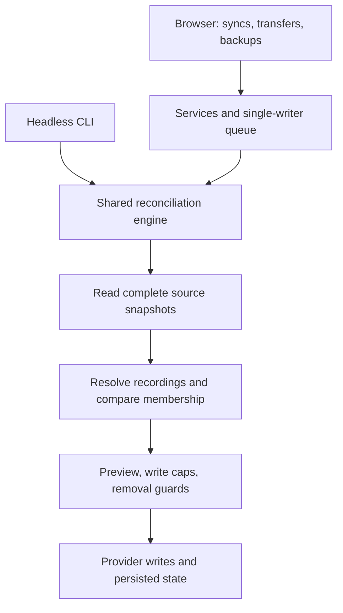

I curate playlists on Spotify but listen on Apple Music, YouTube Music, and a Jellyfin server at home. I built [SongMirror](https://github.com/ahnafnafee/songmirror) to keep those libraries connected without copying every change by hand. It has grown into a self-hosted browser app for scheduled playlist and favorites syncs, multi-source merges, account-to-account transfers, and metadata backups. Seven streaming services sit alongside Last.fm, ListenBrainz, and Navidrome/Subsonic integrations, with a separate local audio mirror for Jellyfin. Docker runs the app and scheduler together; a headless Python CLI uses the same engine. You choose which services define the library and which follow it.

<AppDownloadCTA
  heading='Install and Run SongMirror'
  subtext='Requires Git and Docker with Compose v2.24 or newer. No environment file is needed to start.'
  github='https://github.com/ahnafnafee/songmirror'
  container='https://github.com/ahnafnafee/songmirror/pkgs/container/songmirror'
  documentation='https://github.com/ahnafnafee/songmirror/blob/main/docs/docker-image.md'
>

```bash
git clone https://github.com/ahnafnafee/songmirror.git
cd songmirror
docker compose up -d
```

1. Open [localhost:8888](http://localhost:8888) and connect your services under **Accounts**.
2. Use **Transfers** for a one-time copy, or **Sync** to create a scheduled job. Preview a sync before applying it.
3. Keep `./data` backed up: it holds your configuration, credentials, caches, and history. Compose also preserves downloads under `./downloads` by default.

Compose pulls the published AMD64/ARM64 image. The interface has no login, so keep it on a trusted local network.

</AppDownloadCTA>

<figure className='not-prose my-6'>
  
  <figcaption className='mt-2 text-center text-sm text-gray-500 dark:text-gray-400'>
    One place to manage connected accounts and see what the scheduler is doing.
  </figcaption>
</figure>

## Decide Who Controls the Playlist

A playlist shared across several services needs a rule for whose edits count. SongMirror offers four modes because editing on one app and curating across several apps are different workflows.

| Mode                  | Membership rule                                                          | Useful when                                                          |
| --------------------- | ------------------------------------------------------------------------ | -------------------------------------------------------------------- |
| One-way               | One source defines the playlist                                          | You curate in one app and listen elsewhere                           |
| Merge sources         | Several playlists contribute a deduplicated union to one destination     | You want a combined playlist from library selections or public links |
| Authoritative group   | Selected authorities contribute changes; destination-only mirrors follow | You curate on a few services and want the rest to reflect them       |
| Bidirectional (N-way) | Every selected service contributes changes                               | You actively edit on every participating service                     |

A merge reads all its sources before considering removals. Shared ISRCs identify the same recording; conservative metadata matching handles overlaps without them. Source priority determines ordering, and the first occurrence supplies the display metadata. If any source is incomplete, safe additions can continue while removals stay blocked.

Authoritative groups establish a baseline, then require two consecutive complete reads to confirm an absence. N-way jobs retain per-provider snapshots so a copied addition does not return as a new edit. Both use add-wins conflict resolution. Those distinctions matter when an apparently missing song is a catalog or API problem rather than something I deleted.

## Favorites Beyond Playlists

The same reconciliation engine now handles the seven streaming providers' built-in liked or favorite collections. A Spotify Liked Songs collection can become another service's native favorites or a named playlist. Regular playlists remain separately selectable, so a favorites-only job does not unexpectedly copy the whole library.

Last.fm adds Loved Tracks, Top Tracks across six periods, and Recent Scrobbles as sources. Authorizing it also allows incoming favorites to become Last.fm loves. [ListenBrainz](https://github.com/ahnafnafee/songmirror/blob/main/docs/listenbrainz-subsonic.md) similarly reads public Loved Recordings and accepts incoming favorites with a verified user token. Neither is a general playlist destination.

Navidrome and Subsonic-compatible servers support playlists and starred songs in both directions. Matches resolve against audio already indexed by the server; SongMirror does not upload missing music. Jellyfin remains a browsing and local-mirror integration. I keep those capabilities explicit because connecting an account should not imply that every operation is available.

## Transfers You Can Come Back To

Transfers now work between different services or separate accounts on the same service. A public playlist link can be opened directly without following it first. For [YouTube account migrations](https://github.com/ahnafnafee/songmirror/blob/main/docs/youtube-account-transfers.md), the shared video IDs preserve the original videos, including non-music playlists, instead of searching for substitutes.

A running copy has pause, resume, stop, and unmatched-track review. [Transfer history](https://github.com/ahnafnafee/songmirror/blob/main/docs/transfer-history.md) persists confirmed counts, failures, and status changes in SQLite, with filters for account, service, playlist, and date. A restart marks unfinished attempts interrupted; starting another copy into the same destination skips entries already there.

<figure className='not-prose my-6'>
  
  <figcaption className='mt-2 text-center text-sm text-gray-500 dark:text-gray-400'>
    Transfer records survive container replacement when the application data volume is preserved.
  </figcaption>
</figure>

## Bring a Track List, Keep a Backup

Creating a playlist no longer requires an existing provider playlist. Paste a track list or import TXT, CSV, TSV, M3U, or M3U8, review the proposed matches, and create or append to a destination playlist. The review step gives ambiguous recordings a place to be resolved before writing.

Backups address a different need. Under **Settings → Playlist backups**, an account's playlist metadata can be archived on an independent schedule, with JSON/XML output, retention settings, and visible run history. Manual exports cover a whole service or one playlist; the Soundiiz JSON option provides an import-ready track list for that service.

These snapshots preserve ordered track metadata and unavailable-entry markers, while excluding credentials and streaming-file URLs. They are metadata archives, not audio downloads. A backup also needs no second provider or sync job, which makes it useful before a migration.

## Match the Recording, Then Remember the Decision

Cross-catalog matching still follows the original hierarchy: reuse a cached match, try an ISRC, then score title, artist, and duration. RapidFuzz and anyascii romanization help with credit differences and transliterated titles. Duration and recording-version checks constrain those looser comparisons.

A cached mistake should be repairable. The **Mappings** page exposes saved matches and misses, lets me paste a corrected track reference, and can clear failed lookups for another attempt. Native favorites sync membership only. Playlist destinations can repair relative Recently Added order when a previously missing match becomes available, subject to provider capabilities and write caps.

## Keep the Dangerous Writes Visible

The browser and CLI share the reconciliation core through a services layer and a single-writer queue. Scheduled jobs, transfers, and backup reads take turns using provider clients, while progress reaches the browser through server-sent events.



The CLI is a dry run unless `--execute` is supplied; the browser offers **Preview** before a real sync. Removals are separately opt-in and capped. Empty or incomplete reads, expired credentials, and unresolved replacements can hold deletions back. Transfers append by default, with an optional order-preservation mode where the destination supports it.

## Keep Your Own Audio Library in the Loop

The optional local mirror copies matching files from an existing music library in their original format, so a FLAC stays a FLAC. spotDL can fill missing tracks, and SongMirror writes playlist folders, covers, and `.m3u8` files for Jellyfin. Converting a lossy download to FLAC does not improve its source quality.

Credentials and state stay in the self-hosted data directory and are used to contact the services you connect. Renewable sessions are refreshed where supported; some providers still require a fresh pasted token. The [connection guide](https://github.com/ahnafnafee/songmirror#connecting-each-service) documents those differences.

For upgrades, run `docker compose up -d --pull always` from the checkout. Source, setup, and issue tracking live in the [SongMirror repository](https://github.com/ahnafnafee/songmirror), released under the MIT license. The [portfolio page](/portfolio/songmirror) gives a shorter overview of the app and its implementation.
